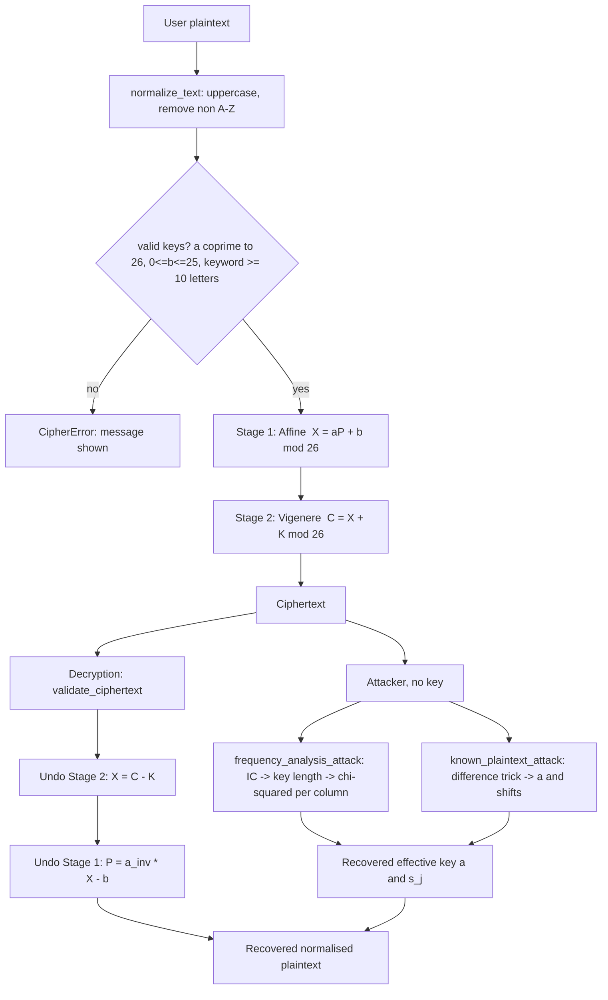
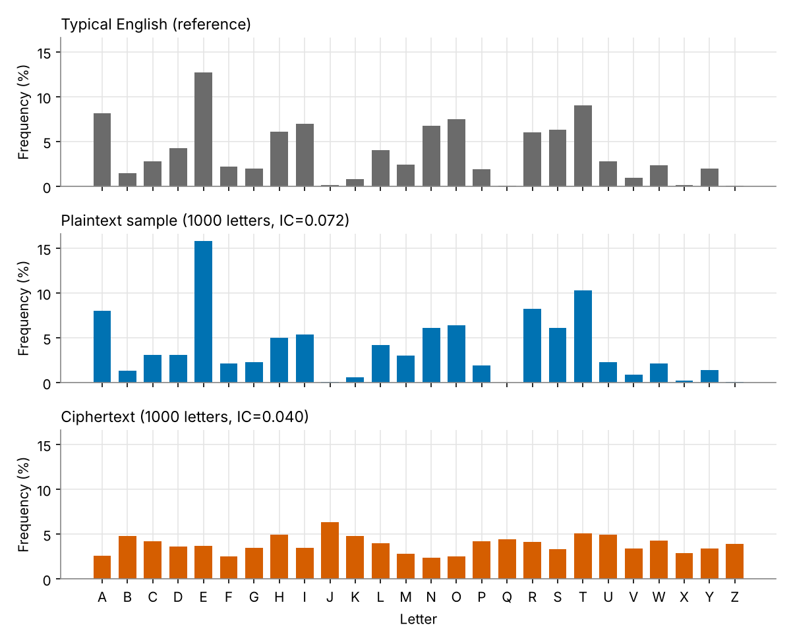
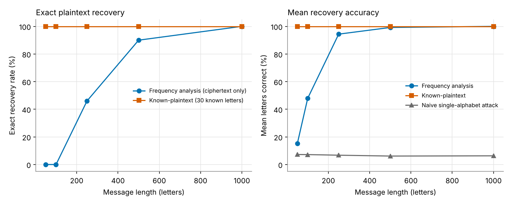
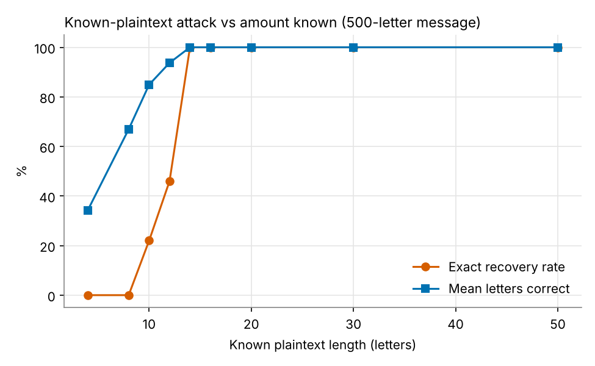
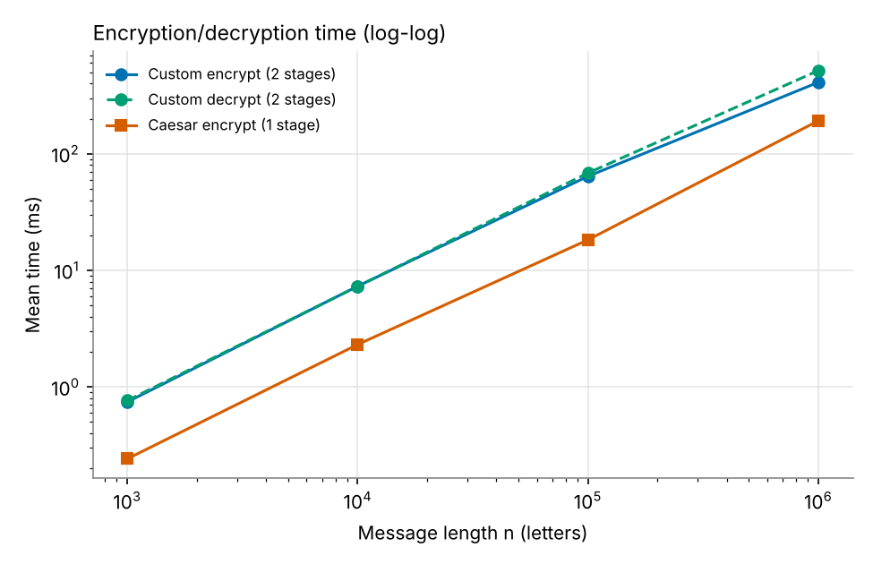
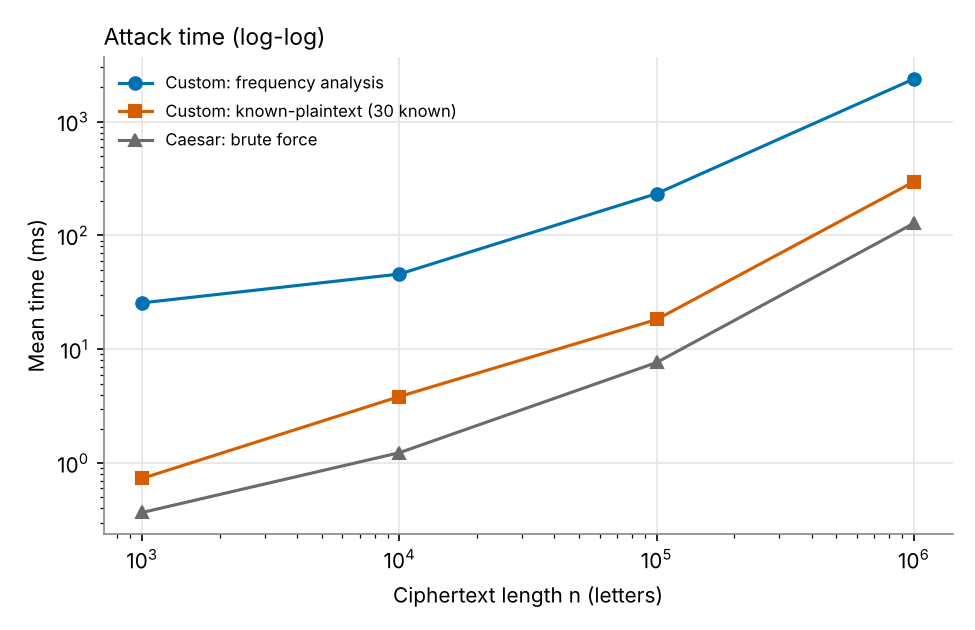
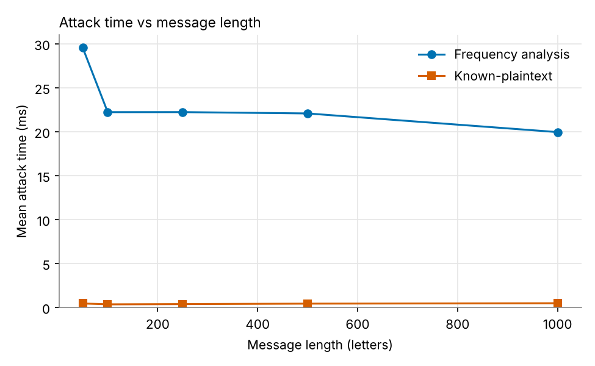

# Design and Break a Custom Cipher Based on Classical Techniques

---

## 1. Cover Page

| | |
|---|---|
| **Course** | Network and Information Security (CT-486) |
| **Project title** | Design and Break a Custom Cipher Based on Classical Techniques |
| **Cipher** | Two-stage cipher: Affine (Stage 1) followed by Vigenère (Stage 2) |
| **Student name / roll no.** | *[to be filled in]* |
| **Instructor** | *[to be filled in]* |
| **Department / University** | *[to be filled in]* |
| **Submission date** | *[to be filled in]* |
| **Code repository** | *[GitHub URL after upload]* |

> **Reading guide.** Every number in Sections 13 and 15–19 was produced by running the code in this repository (`python experiments.py`). Statements about security that were *not* measured are labelled **theoretical**.

---

## 2. Abstract

This project designs a two-stage classical cipher that applies an **Affine cipher** (multiplier *a*, shift *b*) and then a **Vigenère cipher** with a keyword of at least 10 letters. It is implemented from scratch in Python (no cryptographic libraries) with full validation, reversible decryption and a command-line interface. Two attacks are implemented and measured: (1) a ciphertext-only **frequency analysis** that combines Index-of-Coincidence key-length estimation with a column-wise chi-squared search, and (2) a **known-plaintext attack** that exploits the identity C<sub>i+m</sub> − C<sub>i</sub> ≡ a(P<sub>i+m</sub> − P<sub>i</sub>) (mod 26), which removes the key.

Experiments with 50 random key sets for each of five message lengths (50–1000 letters) show that the cipher flattens letter frequencies (mean ciphertext IC ≈ 0.041 against ≈ 0.070 for the English test text), so a naive single-alphabet frequency attack recovers only about 6–7 % of letters. However, the structured attack recovers the plaintext exactly in 0 % of trials at 50 and 100 letters, 46 % at 250, 90 % at 500 and 100 % at 1000 letters. The known-plaintext attack with 30 known letters recovered 100 % of the plaintext at every length, in under 1 ms per attack. An important analytical finding is that the two stages **algebraically collapse** into one: C<sub>i</sub> = a·P<sub>i</sub> + (b + K<sub>i mod m</sub>). The affine shift *b* is therefore redundant with the Vigenère key, and the effective key space is 12·26<sup>m</sup> (≈ 2<sup>50.6</sup> for m = 10), not 12·26·26<sup>m</sup>. The cipher is more complex than Caesar (≈ 2–3.5× slower to run in our measurements, and not breakable by 26 trials), but it is **not** suitable for protecting real data.

**Keywords:** classical cryptography, Affine cipher, Vigenère cipher, frequency analysis, Index of Coincidence, known-plaintext attack, cryptanalysis.

---

## 3. Introduction

Before modern cryptography, secrecy relied on **substitution** (replacing letters) and **transposition** (rearranging them). Classical ciphers are no longer secure, but they remain the best classroom introduction to the vocabulary of the field: keys, key space, diffusion and confusion, attack models, and the principle that security should not rely on keeping the algorithm secret.

A natural idea is to strengthen a weak cipher by applying two of them in sequence (a *product cipher*). Shannon (1949) noted that products of simple ciphers can be much stronger than either alone, and this idea survives in modern ciphers (substitution–permutation networks). But it is *not automatically true*: two linear operations compose into another linear operation. This project builds such a combination and then attacks it to find out, with measurements, how much is actually gained.

## 4. Problem Statement

Design a custom cipher that combines at least two different classical techniques, uses a key of at least 10 characters, supports A–Z and messages of arbitrary length, and is reversible. Then, without using the key, attempt to break it using (a) frequency analysis and (b) a known-plaintext attack; evaluate the attacks experimentally at several message lengths; analyse time complexity against the Caesar cipher; and analyse the security of the design honestly.

## 5. Objectives

1. Design a two-stage cipher using two *different* classical techniques.
2. Implement encryption, decryption, validation and key handling in clean, modular Python.
3. Implement attack simulations that are matched to the real mathematical structure of the cipher.
4. Measure attack success and running time for lengths 50, 100, 250, 500 and 1000.
5. Derive and measure time complexity; compare with the Caesar cipher.
6. Analyse strengths, weaknesses, key space and improvements, and state clearly that the cipher is educational only.

---

## 6. Background of Classical Cryptography

| Technique | Idea | Key | Main weakness |
|---|---|---|---|
| Caesar / shift | C = P + k | 1 value (26 options) | Brute force in ≤ 26 trials; frequencies preserved |
| Affine | C = aP + b | (a, b): 12 × 26 = 312 keys | Still one fixed substitution alphabet; frequencies preserved; two known pairs give the key |
| Monoalphabetic substitution | Arbitrary letter permutation | 26! ≈ 4×10<sup>26</sup> | Letter frequencies preserved → frequency analysis |
| Vigenère | Keyword gives a different shift per position | m letters | Periodic key → Kasiski / IC reveal *m*, then each column is a Caesar cipher |
| Playfair | Digraph substitution, 5×5 table | Keyword | I/J merged, digraph frequencies leak; not a full A–Z alphabet |
| Hill | Matrix multiplication on blocks | n×n invertible matrix | Linear: known plaintext gives the matrix by solving linear equations |

**Key concepts used in this report**

* **Kerckhoffs's principle:** assume the attacker knows the algorithm; only the key is secret. All our attacks assume this.
* **Index of Coincidence (IC):** the probability that two letters drawn at random from a text are equal,
  IC = Σ n<sub>i</sub>(n<sub>i</sub> − 1) / (N(N − 1)).
  English ≈ 0.067, uniformly random letters ≈ 1/26 ≈ 0.038. A monoalphabetic cipher keeps IC ≈ 0.067 (it only relabels letters), so IC reveals whether a text is a mixture of several alphabets.
* **Chi-squared statistic:** χ² = Σ (observed − expected)² / expected, used to measure how English-like a set of letter counts is (lower = closer).
* **Attack models:** *ciphertext-only* (attacker has only ciphertext) and *known-plaintext* (attacker also has some matching plaintext/ciphertext pairs).

---

## 7. Proposed Custom Cipher Design

### 7.1 Phase 1 – Three candidate combinations

| | **Option A: Affine → Vigenère** | **Option B: Keyed substitution → Vigenère** | **Option C: Hill (2×2) → Vigenère** |
|---|---|---|---|
| Stage 1 | C = aP + b (mod 26) | Keyword-mixed 26-letter permutation | Digraph matrix multiplication mod 26 |
| Stage 2 | Vigenère, ≥ 10-letter keyword | Vigenère | Vigenère |
| Full A–Z, reversible, any length? | Yes | Yes | Needs padding for odd length |
| Key | (a, b) + keyword | permutation (from keyword) + keyword | 4 matrix entries + keyword |
| Implementation difficulty | Low | Medium | Medium–high (matrix inverse, padding) |
| Frequency behaviour | Vigenère flattens frequencies, but each column is still an affine cipher with English-shaped frequencies | Same, but each column is an *arbitrary* substitution | Digraph mixing; harder to analyse by hand |
| Natural attack | IC for key length, then 12 × 26 chi-squared search per column | IC for key length, then *hill-climbing* on a permutation (heavy, probabilistic) | Known-plaintext linear algebra; ciphertext-only is hard to present simply |
| Strength of the design | Weak (collapses to one linear map) | Best of the three | Medium |
| Fits "allows meaningful cryptanalysis" and "understandable for a student"? | **Yes – attacks are deterministic and fully explainable** | Attack is complex and slow to demonstrate | Attack explanation is long |

### 7.2 Phase 2 – Decision

**Option A (Affine → Vigenère) is selected.** Reasons:

1. It uses two clearly different classical techniques (a *multiplicative-additive* monoalphabetic substitution, then a *polyalphabetic* substitution), satisfying the assignment directly.
2. It supports the full alphabet A–Z with no letter merging and no padding, so decryption restores the normalised plaintext exactly.
3. Its cryptanalysis is rich yet exactly explainable: IC → key length → per-column chi-squared → recovered effective key; and a mathematically clean known-plaintext attack. This is what the assignment asks for ("allows meaningful cryptanalysis").
4. It exposes an instructive *negative* result (the stages collapse algebraically), which is more valuable to defend in a presentation than a vague claim of "double strength".

**Critical assessment of this choice.** Option B would be a *stronger* cipher. Option A was chosen because the assignment is to design **and break**, and because the weakness can be demonstrated and measured precisely. If the goal were maximum resistance, Option B (or adding a transposition stage) would be preferred; Section 22 discusses this.

### 7.3 Answers to the design questions

1. **Selected techniques.** Affine cipher (Stage 1) and Vigenère cipher (Stage 2).
2. **Why combine them.** The affine stage mixes letters with a *multiplication* (not just a shift), so the ciphertext is not a plain Vigenère cipher; the Vigenère stage removes the single-alphabet weakness of the affine cipher by using a different shift at each position. Each covers a weakness of the other (see 7.5).
3. **How each stage works.** See Section 9.
4. **Key generation/selection.** The key has three parts: *a* (one of 1, 3, 5, 7, 9, 11, 15, 17, 19, 21, 23, 25 — the 12 values coprime to 26), *b* ∈ {0,…,25}, and a Vigenère keyword K of **at least 10 letters** A–Z. Keys can be typed by the user or generated randomly by `generate_random_key()` using Python's `secrets` module.
5. **Decryption.** Undo Stage 2 first (subtract the keyword), then Stage 1 (multiply by a<sup>−1</sup> after subtracting b). Reverse order is essential.
6. **Why more complicated than one stage.** It defeats the two classic one-line attacks: brute force over 26 shifts (Caesar), and direct single-alphabet frequency matching (monoalphabetic). The attacker must first find the key length. See 7.5 for what it does *not* add.

### 7.4 Input handling rules

* Lowercase letters are converted to uppercase.
* **Spaces, digits and punctuation are removed** before encryption. The program reports how many characters were removed. Therefore decryption returns the *normalised* plaintext (capital letters, no spaces), e.g. "Meet me at the library at nine!" → `MEETMEATTHELIBRARYATNINE`.
* Text with no letters at all is rejected.
* Ciphertext input may contain letters and whitespace (e.g. 5-letter groups); any other character is rejected.
* Invalid keys are rejected with a clear message (a not coprime with 26; b outside 0–25; keyword shorter than 10 letters or containing non-letters). Weak keywords (fewer than 5 distinct letters, or an internally repeating keyword) trigger a warning.

### 7.5 Why the combination is more complicated, and the honest caveat

Compared with Caesar, the combined cipher has (i) a larger key space, (ii) a key-dependent period m ≥ 10 so the attacker cannot try 26 shifts, and (iii) near-flat letter frequencies (measured IC ≈ 0.041).

**However**, combining both stages gives, for every position *i*,

> C<sub>i</sub> = a · P<sub>i</sub> + s<sub>(i mod m)</sub> (mod 26),  where s<sub>j</sub> = (b + K<sub>j</sub>) mod 26.

This is a *single* Vigenère-like cipher on a multiplied plaintext. The parameter *b* is absorbed into the keyword shifts and can **never be recovered separately** (and need not be). The effective key is (a, s<sub>0</sub>, …, s<sub>m−1</sub>): 12 · 26<sup>m</sup> possibilities, not 12 · 26 · 26<sup>m</sup>. Stage 1 contributes only the 12-way unknown *a*, which an attacker can search exhaustively. This is the central analytical result of the project, and it is confirmed experimentally in Sections 15–17.

---

## 8. Explanation of Selected Classical Techniques

### 8.1 Affine cipher (Stage 1)

Letters are numbered A = 0, …, Z = 25.

* Encryption: **X = (a·P + b) mod 26**
* Decryption: **P = a<sup>−1</sup>·(X − b) mod 26**, where a·a<sup>−1</sup> ≡ 1 (mod 26).

*a* must be coprime with 26 (gcd(a, 26) = 1); otherwise two different letters would map to the same output and decryption would be ambiguous. This leaves 12 valid values. Example: a = 5, b = 8: H (7) → 5·7 + 8 = 43 mod 26 = 17 = R.

*In simple terms:* it stretches the alphabet by a factor *a* and then slides it by *b*. It is just a fixed letter-for-letter substitution, so letter frequencies are only relabelled.

### 8.2 Vigenère cipher (Stage 2)

With keyword K of length m:

* Encryption: **C<sub>i</sub> = (X<sub>i</sub> + K<sub>i mod m</sub>) mod 26**
* Decryption: **X<sub>i</sub> = (C<sub>i</sub> − K<sub>i mod m</sub>) mod 26**

*In simple terms:* the keyword is repeated along the message, and each letter is shifted by the corresponding keyword letter. Letters in the same keyword position (a "column") share one Caesar shift.

---

## 9. Encryption Algorithm

**Input:** plaintext string, keys (a, b, K). **Output:** ciphertext in A–Z.

1. Convert to uppercase; delete every character not in A–Z; reject if empty. Let P = P<sub>0</sub>…P<sub>n−1</sub>.
2. Validate: a ∈ {1,3,5,7,9,11,15,17,19,21,23,25}; 0 ≤ b ≤ 25; K contains only letters and |K| = m ≥ 10.
3. **Stage 1:** for i = 0…n−1: X<sub>i</sub> = (a·P<sub>i</sub> + b) mod 26.
4. **Stage 2:** for i = 0…n−1: C<sub>i</sub> = (X<sub>i</sub> + K<sub>i mod m</sub>) mod 26.
5. Output C (shown in 5-letter groups).

## 10. Decryption Algorithm

**Input:** ciphertext, keys (a, b, K). **Output:** normalised plaintext.

1. Remove whitespace; reject any character outside A–Z; validate keys as above.
2. **Undo Stage 2:** X<sub>i</sub> = (C<sub>i</sub> − K<sub>i mod m</sub>) mod 26.
3. **Undo Stage 1:** P<sub>i</sub> = a<sup>−1</sup>(X<sub>i</sub> − b) mod 26.
4. Output P.

**Proof of correctness.** a<sup>−1</sup>((aP + b) − b) = a<sup>−1</sup>aP = P (mod 26), and ((X + K) − K) = X, so Decrypt(Encrypt(P)) = P for every normalised P. This was also checked by 300 randomised round-trip tests (`tests/test_cipher.py`) and a hand-computed test vector (see 13.1).

---

## 11. System Architecture / Flowchart



**Module structure**

```
main.py ──► cipher.py        (normalise, validate, Affine, Vigenère, encrypt/decrypt, key generation)
   │
   └─────► attacks.py        (statistics, frequency attack, known-plaintext attack)
experiments.py ──► cipher.py + attacks.py ──► results/*.csv, results_tables.md, performance_graphs/*.png
tests/test_cipher.py ──► cipher.py + attacks.py
```

---

## 12. Python Implementation

The complete source is in the repository; this section summarises it. A line-by-line explanation for presentation use is in `report/code_walkthrough.md`.

| File | Key functions |
|---|---|
| `cipher.py` | `normalize_text`, `validate_ciphertext`, `validate_affine_key`, `validate_vigenere_key`, `key_warnings`, `mod_inverse`, `affine_encrypt/decrypt`, `vigenere_encrypt/decrypt`, `encrypt`, `decrypt`, `encrypt_verbose`, `generate_random_key`, `effective_shifts`, `caesar_encrypt/decrypt` (baseline only) |
| `attacks.py` | `letter_counts`, `frequency_percentages`, `index_of_coincidence`, `chi_squared_vs_english`, `frequency_report`, `naive_rank_attack`, `pooled_ic`, `estimate_key_length`, `frequency_analysis_attack`, `known_plaintext_attack`, `decrypt_with_effective_key`, `accuracy` |
| `experiments.py` | `experiment_lengths`, `representative_runs`, `experiment_known_length`, `experiment_scaling`, `make_graphs`, `build_tables` |
| `main.py` | Interactive menu where the user types their own text and keys: 1 encrypt, 2 decrypt, 3 random keys, 4 encrypt-then-attack, 5 attack a pasted ciphertext, 6 built-in demo, 7 *(optional extra)* repeat the success-rate/time measurements on the user's own plaintext, 8 quit; plus `--demo` |

No cryptographic library is imported. The only library imports are `secrets` (random key generation), `time`, `csv`, `random`, `statistics`, and `matplotlib` for graphs.

---

## 13. Sample Encryption and Decryption

### 13.1 Hand-checkable test vector

Plaintext `hello`, a = 5, b = 8, keyword `ABCDEFGHIJ` (shifts 0,1,2,3,4,…):

| Letter | H | E | L | L | O |
|---|---|---|---|---|---|
| P | 7 | 4 | 11 | 11 | 14 |
| Stage 1: 5P + 8 mod 26 | 17 = R | 2 = C | 63 mod 26 = 11 = L | L | 78 mod 26 = 0 = A |
| Keyword shift | 0 | 1 | 2 | 3 | 4 |
| Stage 2 | R | D | N | O | E |

Ciphertext = **RDNOE** (asserted in `tests/test_cipher.py`).

### 13.2 Sample with punctuation (actual program output)

Input `Meet me at the library at nine!`, a = 5, b = 8, key `ABCDEFGHIJ`:

```
normalized   : MEETMEATTHELIBRARYATNINE      (7 characters removed)
after Affine : QCCZQCIZZRCLWNPIPYIZVWVC
ciphertext   : QDECUHOGHACMYQTNVFQIVXXF
decrypted    : MEETMEATTHELIBRARYATNINE
```

### 13.3 Full demo (actual output of `python main.py --demo`; a = 7, b = 3, key `NETWORKSEC`)

```
Normalised : CLASSICALCIPHERSAREEASYTOSTUDYANDTHEYTEACHUSWHYMODERNCRYPTOGRAPHYNEEDSFARMORETHANACLEVERKEYWORD
After Affine: RCDZZ HRDCR HEAFS ZDSFF DZPGX ZGNYP DQYGA FPGFD RANZB APJXY FSQRS PEGXT SDEAP QFFYZ MDSJX SFGAD QDRCF UFSVF PBXSY
Ciphertext : EGWVN YBVGT UITBG QNKJH QDICL QQFCR QURCO WZYJF EEGVP RZBBA SWJNG GOYBV FHXWD HPXCB ZHLFL JPYEF DHKYT LPKZH CFQOM
Decrypted  : CLASSICALCIPHERSAREEASYTOSTUDYANDTHEYTEACHUSWHYMODERNCRYPTOGRAPHYNEEDSFARMORETHANACLEVERKEYWORD
Round trip OK: True
```

### 13.4 Error handling (verified by unit tests)

| Input | Result |
|---|---|
| a = 2 | Rejected: must be coprime with 26 |
| b = 30 | Rejected: must be 0–25 |
| Keyword `SHORT` | Rejected: needs ≥ 10 letters |
| Keyword `ABCDE12345` | Rejected: letters only |
| Plaintext `123 !!` | Rejected: no letters |
| Ciphertext `AB1CD` | Rejected: invalid character |

---

## 14. Attack Simulation Methodology

**Attacker model.** The attacker knows the algorithm (Kerckhoffs's principle) and has the ciphertext. For the known-plaintext attack, the attacker additionally knows that a specific fragment of the ciphertext, at a known position, is the encryption of a known plaintext fragment. The attacker does not know a, b, or K, nor the key length. For the frequency attack the estimator searches key lengths 1–20 (the design allows longer keys; with m > 20 this attacker would fail unless the search range were widened, which is a limitation of *our implementation*, not of the method).

**Structure exploited.** From Section 7.5: C<sub>i</sub> = a P<sub>i</sub> + s<sub>(i mod m)</sub>. Therefore column *j* (letters j, j+m, j+2m, …) is an **affine** encryption of English text with the *same* a and its own shift s<sub>j</sub>. Affine encryption only relabels letters, so each column's letter frequency *shape* is English.

**Attack A – ciphertext-only (frequency analysis), steps**

1. Compute letter frequencies and IC of the ciphertext (Section 15.1).
2. *Naive attack* (control): treat the text as a single substitution; map the most frequent ciphertext letter to E, next to T, etc. Expected to fail.
3. *Key length:* for each m = 1…20, split into m columns and compute the **pooled IC** (Σ coincidences over all columns ÷ Σ pairs). At the true m (and its multiples) each column is monoalphabetic, so pooled IC ≈ 0.067; at other m it is ≈ 0.04. Choose the **smallest m whose pooled IC is at least 93 % of the best score** (because multiples of m also score high).
4. *Per column:* for each of the 12 multipliers *a* and each of the 26 shifts, decrypt the column's letter counts and compute χ² against English; keep the best shift per column. The *a* with the lowest total χ² wins.
5. *Decrypt* with the recovered (a, s<sub>0..m−1</sub>) and measure the fraction of letters correct.

Cost of the search for fixed m: 12 × 26 × 26 × m ≈ 81 000 multiplications for m = 10 — far less than the 26<sup>10</sup> ≈ 1.4 × 10<sup>14</sup> keywords that a brute force would face.

**Attack B – known-plaintext, steps**

For two positions i and i + m in the same column, the key shift cancels:

> C<sub>i+m</sub> − C<sub>i</sub> ≡ a (P<sub>i+m</sub> − P<sub>i</sub>) (mod 26).

So, given known plaintext, for each of the 12 candidate multipliers *a* compute s<sub>i</sub> = C<sub>i</sub> − a·P<sub>i</sub> along the fragment. Only the correct *a*, with the correct period *m*, produces a sequence that **repeats with period m**. The attack tests m = 1, 2, 3, … and accepts (a, m) when the sequence repeats consistently with at least 4 checked repeats (a false acceptance has probability about 26<sup>−4</sup> per candidate). Once accepted, s<sub>0..m−1</sub> are known and the entire ciphertext (not just the fragment) is decrypted. If the fragment is too short for verification, a *fallback* takes m from the IC estimate, discards inconsistent *a*, and picks among the remaining by English-likeness (χ²) — this is **unverified** and is reported separately.

**Honest limits of the attack model.** The known fragment is at the *start* (position 0) and its position is known; the known text and the test text come from the same English corpus; key lengths in experiments are 10–14.

**What the attack does *not* recover.** *b* and K individually: only the sums s<sub>j</sub> = b + K<sub>j</sub> (mod 26). This is mathematically impossible, not a limitation of the code, and it is also irrelevant for decrypting.

**Evaluation metrics.** *Exact recovery* = recovered plaintext identical to the original. *Letters correct* = fraction of positions that match. *a found* = recovered multiplier equals the true one. Time is measured with `time.perf_counter()`.

**Experimental setup.** Test plaintext: 2 782 letters of original English prose in `experiments.py` (`CORPUS`; IC = 0.0701). For each length L ∈ {50, 100, 250, 500, 1000} and each of 50 trials: a random window of the corpus, a random a, b and a random keyword of 10–14 letters; seed 486 (reproducible). Known-plaintext experiments use the first 30 letters as known text. Experiment 2 varies the known length at fixed L = 500. Experiment 3 measures running time for n = 10<sup>3</sup>…10<sup>6</sup>.

---

## 15. Frequency Analysis Results

### 15.1 Does the cipher preserve or disguise letter frequencies?

Actual output for one 500-letter ciphertext (a = 7, b = 3, key `NETWORKSEC`): IC = **0.0390**, L1-distance from English = 73.7 percentage points. The most frequent ciphertext letter is J at 6.40 % (English: E at 12.7 %), and the *plaintext* letter E is hidden. The graph `results/performance_graphs/frequency_comparison.png` shows English vs plaintext vs ciphertext.



**Table A – Mean over 50 random key sets (actual measurements)**

| Msg length | Ciphertext length | Mean IC | L1 distance from English (pct-pts) | Naive single-alphabet attack: letters correct |
|---|---|---|---|---|
| 50 | 50 | 0.0423 | 87.0 | 7.2 % |
| 100 | 100 | 0.0421 | 81.6 | 7.2 % |
| 250 | 250 | 0.0410 | 75.7 | 6.7 % |
| 500 | 500 | 0.0410 | 72.9 | 6.1 % |
| 1000 | 1000 | 0.0412 | 73.3 | 6.3 % |

*(For reference: 26 random letters would match 1/26 = 3.8 % by chance, so 6–7 % is barely above chance.)*

**Interpretation.** The cipher **disguises** the global frequencies: ciphertext IC ≈ 0.041, close to random (0.0385) and far from English (0.0701 in our corpus). A plain Caesar/affine cipher would keep IC at the plaintext value. Therefore the textbook "most frequent letter = E" attack fails (6–7 % of letters correct, essentially chance). But the *within-column* frequencies are **preserved** (each column is an affine cipher) and this is what the real attack uses.

### 15.2 Structured frequency-analysis attack results

**Table B – Ciphertext-only attack (IC key length + per-column χ²), 50 trials per length**

| Msg length | Exact recovery | Mean letters correct | Key length found (true or multiple) | Multiplier a found | Mean time (ms) |
|---|---|---|---|---|---|
| 50 | 0 % | 15.3 % | 36 % | 26 % | 29.56 |
| 100 | 0 % | 47.9 % | 70 % | 70 % | 22.23 |
| 250 | 46 % | 94.4 % | 100 % | 100 % | 22.23 |
| 500 | 90 % | 99.2 % | 100 % | 100 % | 22.08 |
| 1000 | 100 % | 100.0 % | 100 % | 100 % | 19.96 |



**Representative run (a = 7, b = 3, key NETWORKSEC; true effective shifts s = [16, 7, 22, 25, 17, 20, 13, 21, 7, 5])**

| Msg length | Est. key length | a found | Letters correct | Exact | Wrong shift columns | Time (ms) |
|---|---|---|---|---|---|---|
| 50 | 20 | 7 | 28.0 % | No | n/a (m wrong) | 27.38 |
| 100 | 10 | 7 | 90.0 % | No | 1 of 10 | 13.98 |
| 250 | 10 | 7 | 100 % | Yes | 0 | 14.64 |
| 500 | 10 | 7 | 100 % | Yes | 0 | 14.74 |
| 1000 | 10 | 7 | 100 % | Yes | 0 | 15.81 |

At n = 500 and n = 1000 the recovered effective shifts equal the true ones exactly: `[16, 7, 22, 25, 17, 20, 13, 21, 7, 5]` — i.e. b + K<sub>j</sub> was recovered although neither b nor K was.

### 15.3 Evaluation of the attack, including a flaw found along the way

**Does the attack succeed?** Yes for long ciphertexts: ≥ 90 % exact recovery from 500 letters, 100 % at 1000 in our 50 trials. No for short ciphertexts: with 50–100 letters each column contains only 3–10 letters, too few for χ² to identify the shift reliably, and the key-length estimate is also unreliable. Note that with n = 50 and m = 10, there are only 5 letters per column, and the key-length estimator is guessing. (With 50 trials, a measured rate has a 95 % margin of roughly ±14 percentage points at worst, so differences of a few points are not meaningful.)

**First version of the attack (kept for honesty).** My first key-length estimator used a fixed IC threshold of 0.055. Its results were: exact recovery 0 %, 0 %, 34 %, 68 %, 68 % and letters correct 8.6 %, 28.9 %, 77.7 %, 83.3 %, 82.4 % for lengths 50–1000 (files `results/results_tables_v1_fixed_threshold.md` and `experiment_results_v1_fixed_threshold.csv`). Diagnosing the 1000-letter failures showed *every one* had an estimated key length of **exactly half** the true length (10→5, 12→6, 14→7): mixing two columns with different shifts can still produce IC ≈ 0.057 > 0.055. I replaced the fixed threshold with "smallest m within 93 % of the best score" and re-ran everything; Table B is from the corrected version. **Caveat:** this refinement was made after seeing results on the same experimental setup, so Table B is a slightly optimistic picture of how well a *new* attacker's estimator would generalise; the 93 % constant was chosen from reasoning about the failure, not by searching for the best value.

---

## 16. Known-Plaintext Attack Results

### 16.1 Attack with 30 known letters at the start of the message

**Table C – 50 trials per length**

| Msg length | Exact recovery | Letters correct (all) | Letters correct (unknown part only) | a found | Period verified | Mean time (ms) |
|---|---|---|---|---|---|---|
| 50 | 100 % | 100.0 % | 100.0 % | 100 % | 100 % | 0.464 |
| 100 | 100 % | 100.0 % | 100.0 % | 100 % | 100 % | 0.362 |
| 250 | 100 % | 100.0 % | 100.0 % | 100 % | 100 % | 0.387 |
| 500 | 100 % | 100.0 % | 100.0 % | 100 % | 100 % | 0.444 |
| 1000 | 100 % | 100.0 % | 100.0 % | 100 % | 100 % | 0.491 |

Recovered key information (representative run, all lengths): a = 7, m = 10, s = [16, 7, 22, 25, 17, 20, 13, 21, 7, 5] (exactly the true effective key). The recovered information decrypts **all remaining ciphertext** (the "unknown part" column), which answers the assignment's question about whether the recovered information helps decrypt additional ciphertext: it does, completely.

### 16.2 How much known plaintext is needed?

**Table E – 500-letter messages, 50 trials per row (key length 10–14)**

| Known letters | Exact recovery | Letters correct | a found | Period verified | Key columns recovered | Mean time (ms) |
|---|---|---|---|---|---|---|
| 4 | 0 % | 34.3 % | 100 % | 0 % | 34 % | 2.897 |
| 8 | 0 % | 66.9 % | 100 % | 0 % | 67 % | 3.443 |
| 10 | 22 % | 84.9 % | 100 % | 0 % | 85 % | 4.891 |
| 12 | 46 % | 93.7 % | 100 % | 0 % | 94 % | 5.495 |
| 14 | 100 % | 100.0 % | 100 % | 20 % | 100 % | 3.906 |
| 16 | 100 % | 100.0 % | 100 % | 54 % | 100 % | 2.568 |
| 20 | 100 % | 100.0 % | 100 % | 100 % | 100 % | 0.710 |
| 30 | 100 % | 100.0 % | 100 % | 100 % | 100 % | 0.729 |
| 50 | 100 % | 100.0 % | 100 % | 100 % | 100 % | 0.684 |



**Explanation.** Each known letter reveals exactly one key column (one value of s<sub>j</sub>). With L known letters and key length m, only min(L, m) columns are recovered, so full recovery needs **L ≥ m** (here m is 10–14, which matches the jump at 12–14 letters). The "Period verified" column shows when L ≥ m + 4, so repeating columns confirm the guess; with fewer known letters the attack falls back to the IC estimate of m and picks *a* by English-likeness. In this experiment the fallback found the correct *a* in all 50 trials per row because the other 11 candidates decrypt the long (500-letter) message to nonsense; with a short message the fallback would be far less reliable (not measured separately).

### 16.3 Limitations of the known-plaintext attack

1. It **cannot separate b from K** (nor needs to).
2. If fewer than m letters are known, some columns remain unknown and the corresponding plaintext letters cannot be recovered by this attack alone (Table E, rows 4–12). A hybrid attack (known plaintext for some columns, frequency analysis for the rest) is possible but not implemented.
3. The attacker must know *where* in the message the known text sits.
4. The attack as implemented assumes the *same* key is reused for the whole message and the period m ≤ 40; a one-time key as long as the message (a one-time pad) would defeat it.
5. All experimental plaintexts came from one English-language corpus, and key lengths were 10–14; results for other languages or longer keys are not measured.

---

## 17. Experimental Results and Performance Tables

All results are from `python experiments.py` (seed 486; Python 3.13 on a Linux cloud container; times are machine-dependent). Full data: `results/experiment_results.csv`, `per_trial_results.csv`, `kpa_known_length_results.csv`, `scaling_results.csv`, `results_tables.md`.

### 17.1 Required summary table (one row per message length)

| Msg length | Ciphertext length | Mean IC | Freq. analysis: exact / letters correct / time | Known-plaintext (30 known): exact / time | Recovered key information | Limitation / reason for failure |
|---|---|---|---|---|---|---|
| 50 | 50 | 0.0423 | 0 % / 15.3 % / 29.6 ms | 100 % / 0.46 ms | KPA: a and all s<sub>j</sub> (30 known ≥ m); freq.: unreliable | Only ~5 letters per column; key length mis-estimated in 64 % of trials |
| 100 | 100 | 0.0421 | 0 % / 47.9 % / 22.2 ms | 100 % / 0.36 ms | KPA: complete; freq.: a correct in 70 % | ~10 letters per column; 1–2 wrong shifts break exactness |
| 250 | 250 | 0.0410 | 46 % / 94.4 % / 22.2 ms | 100 % / 0.39 ms | a and m correct in 100 %; some shifts wrong | Occasional wrong shift in sparse columns |
| 500 | 500 | 0.0410 | 90 % / 99.2 % / 22.1 ms | 100 % / 0.44 ms | a, m, s<sub>j</sub> correct in most trials | Rare wrong shift |
| 1000 | 1000 | 0.0412 | 100 % / 100.0 % / 20.0 ms | 100 % / 0.49 ms | Complete effective key | None observed in 50 trials |

For the 50-letter case the 30 known letters are 60 % of the message, so the high KPA result is partly because most of the message is *given*; the 20 unknown letters are also all recovered.

### 17.2 Encryption/decryption time on small messages (microseconds, mean of 50 repeats per trial)

| Msg length | Encrypt (µs) | Decrypt (µs) |
|---|---|---|
| 50 | 33.8 | 34.6 |
| 100 | 54.4 | 58.5 |
| 250 | 128.6 | 126.8 |
| 500 | 252.1 | 262.5 |
| 1000 | 436.2 | 431.1 |

### 17.3 Scaling to large inputs (milliseconds; mean of 20 / 5 / 2 repeats for small / medium / large n)

| n | Custom enc | Custom dec | Caesar enc | Caesar dec | Frequency analysis | Known-plaintext (30 known) | Caesar brute force |
|---|---|---|---|---|---|---|---|
| 1 000 | 0.744 | 0.765 | 0.242 | 0.245 | 25.567 | 0.734 | 0.368 |
| 10 000 | 7.316 | 7.292 | 2.312 | 2.276 | 45.777 | 3.844 | 1.234 |
| 100 000 | 64.075 | 68.414 | 18.271 | 21.356 | 232.930 | 18.266 | 7.653 |
| 1 000 000 | 410.135 | 516.615 | 191.918 | 155.140 | 2372.998 | 296.747 | 127.924 |





**Variance warning.** Timings from a shared container fluctuate: in an earlier complete run the 10 000-letter custom encryption took 5.95 ms (vs 7.32 ms here) and the 1 000 000-letter run 494.6 ms (vs 410.1 ms). Use the *trend* (linear growth, constant-factor ratios), not individual values.

---

## 18. Time Complexity Analysis

Let n = message length, m = key length, |A| = 12 (valid multipliers), L = length of known plaintext, P = maximum period searched (40), and R = maximum key length searched by the frequency attack (20).

| Operation | Operations (counting passes over the text) | Big-O | Notes |
|---|---|---|---|
| **Custom encryption** | normalise (1 pass) + affine (1 pass) + Vigenère (1 pass); key validation O(m) | **O(n + m)** = O(n) | ~2 arithmetic passes plus normalisation |
| **Custom decryption** | validate (1 pass) + undo Vigenère + undo affine; computing a<sup>−1</sup> is O(26) = O(1) | **O(n + m)** = O(n) | Same as encryption |
| **Frequency analysis** | key-length estimate: R pooled-IC computations, each one pass → R·n; per-column search 12·26·26·m = O(1) for fixed m; final decrypt n | **O(R·n + \|A\|·26²·m)** = **O(n)** for constant R, m | Fixed ≈ 20 ms overhead; linear after ≈ 10<sup>4</sup> letters |
| **Known-plaintext attack** | for each m ≤ P, each a: scan L letters (early exit on first mismatch); final decrypt n | **O(\|A\|·P·L + n)** worst case, ≈ O(n) for fixed L | Typical cost tiny because mismatches exit early |
| Caesar encryption/decryption | normalise + 1 pass | O(n) | |
| Caesar brute force | count letters once O(n), then 26 shifts × 26 letters | O(n + 26²) | |

**Why multiple stages need more processing.** Each stage is another full pass over the text, with its own multiplication/addition and modulo operations and character-code conversions, so the constant factor grows with the number of stages even though the Big-O class (linear) does not change. Our measurements show custom encryption ≈ **2.1–3.5×** slower than Caesar encryption across sizes. Caveat: our `encrypt()` also performs normalisation and key validation whereas the `caesar_encrypt()` baseline function does not, so a share of the ratio comes from normalisation, not the extra cipher stage.

**Observed vs theoretical.** Going from 10<sup>5</sup> to 10<sup>6</sup> letters, custom encryption time rose by about 6.4× (64 → 410 ms), frequency analysis by about 10× (233 → 2373 ms) and Caesar encryption by about 10.5×. This is consistent with linear growth O(n) (10× expected), with noise. The measured encryption time per letter is about 0.4–0.7 µs. The frequency attack at small n is dominated by the fixed 12·26·26·m search (≈ 20–30 ms, which is why the 50–1000-letter times in Table B are nearly constant).

### Comparison table: custom cipher vs Caesar

| Aspect | Caesar (single stage) | Custom (Affine → Vigenère) |
|---|---|---|
| Stages | 1 | 2 |
| Encrypt / decrypt complexity | O(n) | O(n) (≈ 2–3.5× constant, measured) |
| Key space | 26 | nominal 12·26·26<sup>m</sup> ≈ 2<sup>55.3</sup> (m = 10); effective 12·26<sup>m</sup> ≈ 2<sup>50.6</sup> |
| Ciphertext IC | ≈ plaintext IC (≈ 0.067) | ≈ 0.041 (measured) |
| Brute-force attack | 26 trials, O(n + 26²) | infeasible by plain search (≈ 10<sup>15</sup>); but structured attack cost ≈ O(n) |
| Frequency attack | Works with any text length (a few letters suffice) | Needs ≈ 250–500+ letters (measured) |
| Known-plaintext | 1 pair of letters | ≥ m letters (≈ 10–14) |
| Attack time (n = 10<sup>4</sup>) | 1.2 ms | 45.8 ms (freq.) / 3.8 ms (KPA) |

---

## 19. Comparison with Caesar Cipher

* **Security gain (measured):** the Caesar cipher is broken by trying 26 shifts and needs no key-length search; the custom cipher resists that and the naive frequency attack (6–7 % letters correct), forcing an attacker to implement IC key-length estimation and column-wise χ². This is a genuine, if modest, improvement.
* **Cost (measured):** about 2–3.5× more encryption time, still microseconds for realistic messages.
* **Security gain (limits):** the attack work remained linear in n and on the order of tens of milliseconds even at 10<sup>6</sup> letters (≈ 2.4 s). Both ciphers fall to a student-written script: the custom cipher raises the *difficulty of the attack code*, not the *computational cost of the attack*.
* **Known-plaintext:** Caesar falls to a single known letter; the custom cipher requires about m known letters, a real but small increase.

---

## 20. Security Analysis

### 20.1 Strengths

1. Resists brute force over the *whole* key space by naive means: effective 12 · 26<sup>10</sup> ≈ 1.7 × 10<sup>15</sup> ≈ 2<sup>50.6</sup> keys at the minimum length m = 10 (2<sup>60</sup> at m = 12, 2<sup>69.4</sup> at m = 14), compared with 26 for Caesar and 312 for the Affine cipher alone. *Theoretical:* a brute force at 10<sup>9</sup> keys/second would need ≈ 20 days at m = 10 — but see 20.3, the structured attack avoids this entirely.
2. Flattens letter frequencies (measured IC ≈ 0.041), defeating the textbook one-alphabet frequency attack (measured 6–7 % letters correct).
3. Short messages (≲ 100 letters) resisted the ciphertext-only attack in our experiments (0 % exact recovery at 50 and 100 letters; Table B) — *with the caveat that we tested a particular estimator and not every possible attack*.
4. The structure is simple enough to verify (round-trip tests, a hand-computed vector).

### 20.2 Weaknesses of the classical techniques selected

* **Affine:** linear; a single fixed substitution; any two known letter pairs (with the difference invertible mod 26) give the key.
* **Vigenère:** periodic key; the Kasiski test / Index of Coincidence reveals the period; each column then reduces to Caesar-like cryptanalysis.
* **Their composition:** linear over the integers mod 26 — see 20.3.

### 20.3 Effect of combining the stages

C<sub>i</sub> = a·P<sub>i</sub> + (b + K<sub>i mod m</sub>) is a **single** Vigenère on an a-multiplied plaintext. Consequences (theoretical, and confirmed by the experiments):

* *b is redundant.* Changing b → b + t and every K<sub>j</sub> → K<sub>j</sub> − t gives the identical cipher, so 26 key sets are equivalent. Effective key space is 12·26<sup>m</sup>, not 12·26·26<sup>m</sup>.
* *Stage 1 adds only the 12-way unknown a*, which an attacker enumerates in 12 cheap steps.
* *The "2×" complexity in the design translates into about ×12 of attack work on top of a Vigenère attack*, which is negligible (≈ 20 ms in our measurements).

So combining stages here is **not** like a modern product cipher. A security gain would require stage 1 to be *nonlinear* or to *move letters* (see Section 22).

### 20.4 Key length and key space

Longer keys raise the exhaustive-search cost exponentially (×26 per extra letter) but do **not** raise the cost of the statistical attack much: the attack cost is 12 · 26 · 26 · m (linear in m), while the data needed grows linearly (about 25–50 letters per key letter for reliable χ² per column). The attack therefore struggles only when n is *not much larger than m* — a key of length 1000 letters on a 1000-letter message is a one-time pad, the single provably secure design (if the key is random and never reused).

### 20.5 Frequency-analysis resistance

*Measured:* resists the naive attack; does **not** resist column-wise analysis for n ≥ 250 (46 % exact at 250, 90 % at 500, 100 % at 1000, mean letters correct 94–100 %).

### 20.6 Known-plaintext vulnerability

*Measured:* 100 % full-message recovery with 14+ known letters (for keys of 10–14 letters), 0.4–5 ms. Real messages begin with predictable headers ("DEAR SIR", protocol keywords), so known-plaintext is realistic.

### 20.7 Repeated patterns

Because the key repeats every m letters, identical plaintext fragments at distances that are multiples of m produce identical ciphertext fragments (Kasiski examination). Our attack uses IC rather than Kasiski, but the repeat structure is the same weakness. It also means *reusing the key for a second message gives the attacker a second ciphertext aligned to the same shifts*, a "depth" attack not implemented here.

### 20.8 Why it must not protect real data

It has no resistance to modern known/chosen-plaintext attacks, no diffusion (changing one plaintext letter changes only one ciphertext letter), no integrity/authentication (anyone can alter ciphertext letters), a 50-bit effective key at the minimum length, and a break that costs milliseconds on a laptop. Modern ciphers (AES-GCM, ChaCha20-Poly1305) must be used for real data.

---

## 21. Limitations

**Of the cipher:** linear algebraic collapse; redundant b; periodic key; letters only (no digits/spaces/case in the plaintext space); no integrity protection.

**Of the experiments (be careful when citing):**

1. One English corpus (2 782 letters of original prose, IC 0.0701); trial windows overlap, so the 50 trials per length are *not independent samples*; margins of error at 50 trials are ≈ ±14 percentage points at worst.
2. Key lengths 10–14 only; the estimator searches m ≤ 20.
3. The known-plaintext fragment is always at position 0 and is drawn from the same text.
4. Timings are from a shared Linux container with Python's interpreter overhead; they vary by ±20 % between runs and should be used for *trends*.
5. The key-length estimator was revised once after observing results on this same setup (Section 15.3).
6. No attack was implemented for key lengths over 20, repeated key use across messages, or hybrid (partial known-plaintext + frequency) attacks.

## 22. Suggested Improvements

Ordered by benefit per added complexity (all *theoretical* predictions; not implemented or measured in this project):

1. **Replace the Affine stage by a keyed monoalphabetic substitution** (a 26-letter permutation generated from a keyword). This removes the algebraic structure: the attacker can no longer enumerate 12 multipliers; each column becomes an arbitrary substitution, so χ² per shift no longer applies and hill-climbing is required. Key space of the substitution alone is 26! ≈ 4 × 10<sup>26</sup>. Known-plaintext attack still recovers the substituted letters seen.
2. **Add a transposition stage** (e.g. columnar), which destroys the column structure the IC / per-column attacks rely on.
3. **Autokey or running-key variant of Vigenère** (the plaintext extends the key) so the key does not repeat; stronger than a repeating key (still classical).
4. **Use a key as long as the message** (one-time pad); *only* if truly random and never reused, this is the one classical-style scheme with proven security.
5. **Never reuse keys**; add a per-message random value (nonce) mixed into the key.
6. **Add authentication** (not classical): a MAC to detect modification.
7. For anything real: use a vetted authenticated cipher.

---

## 23. Conclusion

A two-stage Affine → Vigenère cipher was designed, implemented, and tested. The implementation is reversible, validates all inputs, and supports messages of arbitrary length. Experiments show that the design genuinely disguises letter frequencies (IC ≈ 0.041; naive frequency matching ≈ chance) and is more costly than Caesar (≈ 2–3.5×). Both attacks nevertheless broke it, and why is predictable from the algebra: the two linear stages collapse into one Vigenère-like cipher on a multiplied plaintext, making *b* redundant and reducing the Affine stage to a 12-way search. A ciphertext-only attack needed roughly 250–1000 letters (46 % exact at 250, 90 % at 500, 100 % at 1000), and a known-plaintext attack needed only about as many known letters as the key length (14 letters sufficed for 100 % recovery of 500-letter messages).

The main lesson is that composing ciphers is only worthwhile when the stages do not combine algebraically; the second lesson is that security claims must be tested against an attack that matches the cipher's structure. The project's cipher is educational and must not be used for real information.

---

## 24. References

1. W. Stallings, *Cryptography and Network Security: Principles and Practice*, Pearson (any recent edition) — classical ciphers, Affine/Vigenère, attack models.
2. A. Menezes, P. van Oorschot, S. Vanstone, *Handbook of Applied Cryptography*, CRC Press, 1996 — Chapter 1 (overview), product ciphers.
3. D. Kahn, *The Codebreakers*, Scribner, 1967 — history of the Vigenère cipher and its breaking.
4. S. Singh, *The Code Book*, Doubleday, 1999.
5. C. E. Shannon, "Communication Theory of Secrecy Systems," *Bell System Technical Journal* 28(4), 1949 — product ciphers, confusion/diffusion.
6. A. Kerckhoffs, "La cryptographie militaire," *Journal des sciences militaires*, 1883 — Kerckhoffs's principle.
7. F. W. Kasiski, *Die Geheimschriften und die Dechiffrir-Kunst*, 1863 — Kasiski examination.
8. W. F. Friedman, *The Index of Coincidence and Its Applications in Cryptography*, Riverbank Publication No. 22, 1922.
9. R. Lewand, *Cryptological Mathematics*, MAA, 2000 — source of the commonly reproduced English letter-frequency table used in `attacks.py` (the values are the widely published ones; please verify against your own edition before citing the table).
10. Python Software Foundation, *Python 3 documentation*: `time.perf_counter()`, `secrets`, `statistics`.

*Note: the references above are standard works named from knowledge; they were not re-fetched during this project, so check page/edition details before final submission.*
